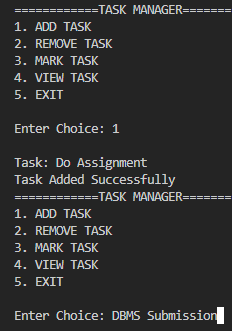
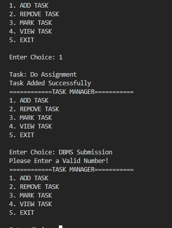
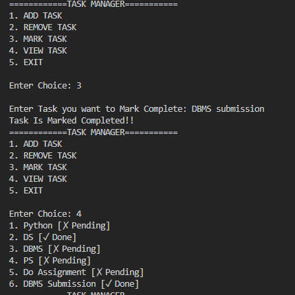
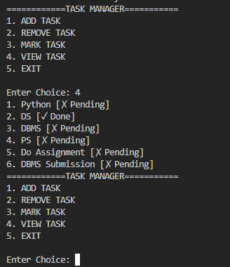

## PERSONAL TASK MANAGER

-A simple command-line task management application built using Python. It allows users to add, view, mark complete, and delete tasks, with persistent data storage using JSON

## FEATURES:

-Add Tasks: Create new tasks.
-View Tasks: Display all tasks with their current status.
-Complete Tasks: Mark pending tasks as completed.
-Delete Tasks: Remove tasks from the list.
-Persistent Storage: Automatically save tasks in a JSON file.
-Error Handling: Handle invalid menu inputs and missing JSON files.
-Case-Insensitive Search: Find tasks regardless of capitalization.

## Technologies Used

-Python 3
-JSON
-Object-Oriented Programming (OOP)
-File Handling
-Exception Handling

##  Project Structure

Personal-Task-Manager/
│
├── main.py
├── tasks.json
└── README.md

## How to run

-1.Clone the repository:
git clone https://github.com/Aryan-chaudhari09/Personal_Task_Manager.git

-2.Navigate to the project directory:
cd Personal_Task_Manager

-3.Run the application:
python main.py

## Screenshots

### Main Menu

### add

### complete

### view

## What I Learned

-Through this project, I practised:
-Working with Python lists and dictionaries.
-Implementing classes and static methods.
-Understanding JSON data serialization and deserialization.
-Reading and writing files in Python.
-Handling exceptions using try-except.
-Implementing CRUD (Create, Read, Update, Delete) operations.
-Organizing application logic.

Author: Aryan-chaudhari09

Built as part of my Python learning journey.
